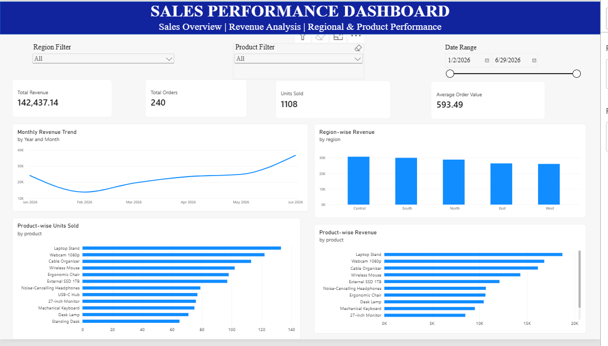

# Sales Performance Dashboard

## Project Overview
This project analyzes 240 sales order records from January to June 2026 using Microsoft Excel and Power BI. It provides insights into revenue, orders, product performance and regional sales.

## Tools Used
- Microsoft Excel
- Microsoft Power BI

## Key Performance Indicators (KPIs)
- **Total Revenue:** ₹142,437.10
- **Total Orders:** 240
- **Units Sold:** 1,108
- **Average Order Value:** ₹593.49

## Project Features
- Data cleaning and validation using Excel
- Data analysis using PivotTables and PivotCharts
- Interactive Power BI dashboard
- Revenue and product performance analysis
- Region, product and date slicers
- Executive Summary dashboard

## Repository Structure
- `Dataset/` – Original and cleaned datasets
- `Documentation/` – Project documentation and README
- `PowerBI/` – Power BI dashboard
- `Presentation/` – Project presentation
- `Screenshots/` – Dashboard and project evidence

## Key Learning Outcomes
- Practiced data cleaning and validation.
- Developed analytical skills using Excel.
- Created interactive dashboards using Power BI.
- Learned to present sales insights through visualizations.

## Project Limitations
Profit and conversion rate analysis were not included because the available dataset did not contain cost or website traffic information.

## Dashboard Preview

## Author
Ekkurthi Rekha

**Project:** Sales Performance Dashboard  
**Tools:** Excel and Power BI
